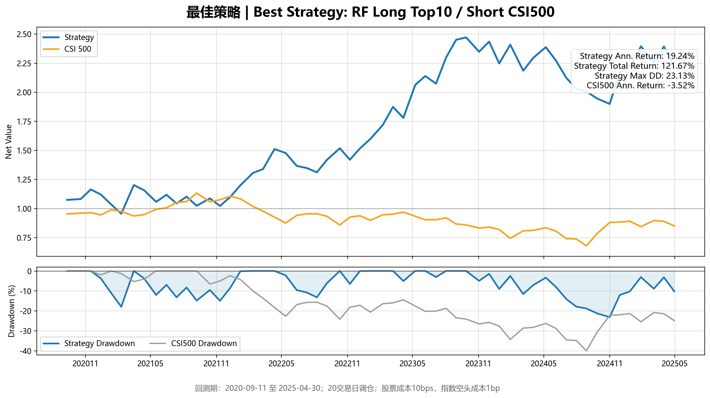

# Machine Learning Multifactor Stock Selection

[中文说明](README.zh-CN.md) | [Research design](docs/RESEARCH_DESIGN.md) | [Data guide](docs/DATA.md) | [Limitations](docs/KNOWN_LIMITATIONS.md)

A Python research project comparing **Random Forest, XGBoost and LightGBM** for historical CSI 500 stock selection, with Tushare data acquisition, 24 factors, chronological validation, decile analysis and transaction-cost-aware portfolio comparisons.

**Status: portable research archive, not a production strategy.** Existing results are retained for transparency. The legacy dataset filters both training and backtest rows using future-return labels. That creates ex-post universe selection in the backtest. Read [known limitations](docs/KNOWN_LIMITATIONS.md) before interpreting the figures. Packaging has not established unbiased performance.

## 1. Objective

Study nonlinear relationships between fundamental/market factors and subsequent benchmark-relative returns. The project began as a practical adaptation of the Bohai Securities report *基于随机森林的多因子选股模型构建*, then added boosting models, historical membership, validation-based parameter selection and hedged portfolio experiments. It is not an exact reproduction of every rule in the original paper.

## 2. Current status

- Complete source pipeline: download -> calendar -> historical universe -> features -> labels -> dataset -> model selection -> portfolios.
- XGBoost and LightGBM each use six predefined candidate configurations; selection uses validation accuracy, then lower log loss, then a smaller train-validation gap.
- Historical results, parameter tables, three NAV/drawdown figures, a Word research report and a PowerPoint presentation are included.
- No raw provider data, account credentials or serialized models are distributed.
- Packaging checks and deterministic unit tests are provided. A new full-sample download/train/backtest has not been run for this release.

## 3. Layout

```text
run_research.py             # unique public entry point
config/                    # portable base and improved configurations
src/                       # data pipeline and original baseline modules
src/improved_v2/           # validation split, tuning and extended portfolios
src/utils/                 # I/O, Tushare, finance, technicals, preprocessing
data/                      # local provider inputs and generated panels (ignored)
outputs/                   # newly generated models/results (ignored)
results/reference/         # archived CSV/JSON result snapshot
reports/                   # archived Word/PPT, figures, HTML overview
docs/                      # design, factor dictionary, limitations, release notes
tools/                     # repository checks and saved-results HTML rendering
tests/                     # deterministic regression and alignment checks
.env.example               # required variable names, no real values
requirements.txt           # supported dependency ranges
```

## 4. Data

Source: **Tushare Pro**. Configured sample: **2010-01-04 to 2025-04-30**. Benchmark: CSI 500 (`000905.SH`). Rebalance interval: 20 trading days. Historical `index_weight` observations determine membership using the latest available snapshot on or before each rebalance date.

Required endpoints: `trade_cal`, `stock_basic`, `daily`, `daily_basic`, `adj_factor`, `index_daily`, `index_weight`, `fina_indicator`, `balancesheet`. Access may require Tushare points or separate permissions. The download collects broad A-share market/financial panels; the research universe is then restricted to historical CSI 500 members. See [field descriptions and provenance](docs/DATA.md).

## 5. Environment

Python **3.11 or 3.12** is recommended. From the repository root:

```bash
python -m venv .venv
python -m pip install --upgrade pip
python -m pip install -r requirements.txt
```

Activate `.venv` before installing on a new machine. PowerShell: `.venv\Scripts\Activate.ps1`; macOS/Linux: `source .venv/bin/activate`.

Set `TUSHARE_TOKEN` in the shell, or create a local `.env` with the format in `.env.example`. Existing shell values take precedence. Never put a real token into YAML or commit `.env`. All paths are resolved from this repository, so the code does not depend on the author's workstation.

The dependency file uses bounded ranges, not an exact historical lock. Retrained models may vary between library versions; the packaging verification environment is recorded in `docs/verification_environment.txt`.

## 6. Run commands

Safe offline inspection (no third-party libraries required):

```bash
python run_research.py --stage check
python -m unittest discover -s tests -v
```

Full pipeline (requires provider permissions, potentially lengthy download and sufficient memory):

```bash
python run_research.py --stage all
```

Or run sequentially:

```bash
python run_research.py --stage download
python run_research.py --stage prepare
python run_research.py --stage research
```

The default modeling path preserves the latest archived methodology, including the limitations above. `prepare` converts large downloaded gzip CSV caches into Parquet, then builds calendars, membership, features and labels. `research` builds four chronological splits, trains/selects/refits models, executes the three portfolio variants and renders a report. `backtest` reruns only portfolios and requires locally generated datasets and models.

Resume downloads in smaller batches:

```bash
python src/01_download_tushare.py --stage foundation
python src/01_download_tushare.py --stage market --year-start 2020 --year-end 2021
python src/01_download_tushare.py --stage financial --financial-start-part 1 --financial-end-part 5
```

Run all needed years and financial chunks before `prepare`. Cache files are local and ignored by Git. Do not upload them simply because the project can regenerate them.

View historical results without data access or model training:

```bash
python tools/build_results_report.py
```

Open `reports/results_overview.html`. This is a **saved-results renderer**, not a newly executed backtest.

## 7. Inputs

- `config/config.yaml`: dates, endpoint pacing, 24-factor preprocessing, RF baseline and paths.
- `config/config_improved.yaml`: 50/10/10/30 split, top-N/deciles and transaction costs.
- Local `data/raw/`: actual downloaded provider observations.
- `prepare` creates `feature_panel.parquet` and `label_panel.parquet`, required by `research`.
- `research` creates models and `backtest_dataset_improved.parquet`, required by `backtest`.

## 8. Outputs

Generated files are written to `data/processed/`, `data/features/`, `data/labels/`, `outputs/improved_v2/`, `reports/improved_v2/` and `outputs/report.html`. Important outputs include `dataset_metadata_improved.json`, `validation_tuning_results.csv`, `validation_selected_params.json`, `extended_strategy_summary.csv`, `extended_strategy_nav.csv`, `extended_strategy_period_returns.csv`, `decile_backtest.csv` and three model files. Do not load untrusted `.joblib` files.

`results/reference/` is a frozen snapshot copied from the previous research run; new executions do not overwrite it. See [result catalog](docs/RESULTS.md).

## 9. This release

Created a separate GitHub-ready folder; replaced workstation paths; restricted credential loading to `TUSHARE_TOKEN`; added the unique entry point, dependency declarations, bilingual README, data acquisition guide, result provenance, HTML overview, tests and a credential/path scanner. The original working project is untouched. See [release notes](docs/CHANGELOG.md).

## 10. Known issues and unfinished work

Priority issues: label-dependent backtest selection, full-panel fallback imputation, overlapping label horizons, period-frequency risk estimates, historical financial restatements, and simplified shorting/execution assumptions. Archived documents and charts predate this audit and may contain stronger language than warranted. Their headline numbers must be read with these disclosures. See [the detailed issue list](docs/KNOWN_LIMITATIONS.md).

## 11. Archived findings

| Model | Portfolio | Total return | Annualized | Sharpe | Max drawdown |
|---|---|---:|---:|---:|---:|
| Random Forest | Long Top 10 / Short CSI 500 | 121.67% | 19.24% | 0.791 | 23.13% |
| Random Forest | Long Top 10 | 104.84% | 17.18% | 0.741 | 35.73% |
| LightGBM | Long Top 10 / Short CSI 500 | 63.58% | 11.49% | 0.529 | 42.18% |
| XGBoost | Long Top 10 / Short CSI 500 | 41.60% | 7.99% | 0.408 | 40.57% |

**These are archived, biased research statistics, not verified investment performance.** Their useful lesson is that model classification accuracy and portfolio risk-adjusted performance can disagree. Extreme loss in the Long Top 10 / Short Bottom 10 experiment is separate from ten-decile analysis.



## Publication and attribution

Prepared by Wu Yangjie. Provider data and the original broker report are not included. Public redistribution of those materials requires checking the relevant rights and terms. This repository does not grant a blanket open-source license; choose a code license after confirming ownership and publication rights for internship-related work. No GitHub remote is configured and nothing has been uploaded by this packaging operation.
