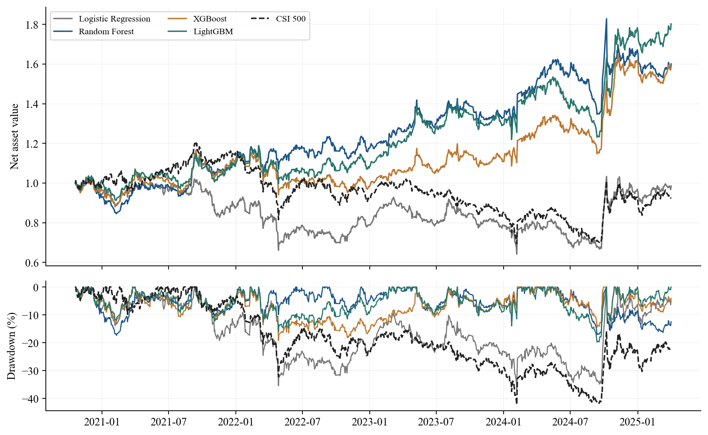

# MH6805 第12组机器学习多因子选股课程项目

[English README](README.md) | [同学阅读指南](docs/CLASSMATE_GUIDE.md) | [数据获取与字段](docs/DATA_ACCESS.md) | [结果解读](docs/RESULTS_EXPLAINED.md) | [详细方法](docs/METHODOLOGY.md)

**这是经过重新实现和实际运行的课程版本，与仓库根目录的早期实习研究版本不同。请勿混用两个版本的代码、配置或收益结果。**

组员：Wu Yangjie（吴阳杰）、Zhao Jingjie、Wang Zhaobo，三人均等贡献。

## 1 项目研究什么

我们使用历史中证500股票，构造基本面和市场交易因子，比较逻辑回归、随机森林、XGBoost、LightGBM 能否识别未来相对收益较高的股票，并检验预测优势能否转化为扣除交易成本后的投资收益。项目重点是机器学习实验设计、时间约束、可解释性和金融评价，而不是宣称发现了稳定套利或可直接实盘的策略。

## 2 不写代码应该先看什么

1. 先看[同学阅读指南](docs/CLASSMATE_GUIDE.md)，建立完整流程概念。
2. 阅读[Word 报告](deliverables/Group12_Final_Report.docx)或[7页英文 PDF](deliverables/Group12_Final_Report.pdf)，两者正文口径一致。
3. 查看[14页汇报 PPT](deliverables/Group12_Presentation.pptx)和[英文讲稿](deliverables/Group12_Speaker_Notes.md)。
4. 下载[离线图文 HTML](deliverables/Group12_Results.html)，用浏览器打开。GitHub 直接预览可能只显示源代码。
5. 需要引用数字时，对照[结果解读](docs/RESULTS_EXPLAINED.md)和 `results/` 中对应表格。

以上阅读不需要 Python、Tushare 积分或 Token。**查看已有结果不等于重新训练、重新回测。**

## 3 完成状态与公开边界

课程版已经在本地真实数据上完成：数据准备、时间序列交叉验证、四模型训练、分类及排序评价、每日持仓回测、40组因子实验、置换重要性、十分组分析、交易成本敏感性和分时期分析。本地9项确定性单元测试及计算结果审计通过。`results/verification.json` 是该次本地运行的审计记录，不代表下载 GitHub 后已经重新执行全流程。

公开内容包括完整科研代码、固定配置、测试、汇总结果表、图片、Word/PDF/PPT/讲稿和 LaTeX。**不公开**付费原始数据、个股级处理后面板及预测、训练模型文件、原 proposal PDF、个人电脑环境信息。公开仓库下载后可以阅读和运行单元测试；只有按授权取得真实缓存后，才能重新训练和回测。缺少数据时不会用模拟数据冒充实证结果。

## 4 研究流程

```text
Tushare 本地真实缓存
  -> 历史中证500成分和当时合格股票池
  -> 只用当时已公开的信息计算25个因子
  -> 按未来相对收益构造训练标签
  -> 按时间划分训练 验证 测试 后续回测
  -> 训练期交叉验证选择模型参数
  -> 在完整合格股票池打分
  -> Top 10组合 每日净值 扣除成本
  -> 分类 排序 投资表现和稳健性解释
```

### 股票池与因子

原始缓存区间为 **2010-01-04 至 2025-04-30**，使用历史中证500成分，不是拿今天的500只股票倒推历史。每个信号日只选择日期不晚于当天的最近成分快照，且快照最多陈旧62个自然日。此规则仍存在成分快照发布时间和覆盖范围的不确定性。

25个因子分为7类：估值4个、成长3个、质量5个、杠杆与流动性4个、动量2个、交易与风险6个、规模1个。具体公式和代理变量局限在[方法说明](docs/METHODOLOGY.md)。并不是把所有原研报字段原样复制到 Tushare；部分字段采用明确说明的替代指标。

### 财务信息不能提前使用

报告期末日期不是信息公开日期。财务指标按公告日加1个自然日作为可用日；资产负债表按公告日与实际公告日的较晚者再加1日。超过550日的财务记录视为陈旧缺失。较晚发布的旧报告期记录不能覆盖已经公开的新报告期记录。供应商历史修订版本仍无法完全还原，因此不能声称彻底消除了全部未来信息风险。

### 缺失值和样本

入选要求为当期有正成交量和有效报价、至少60条历史股票记录、60条记录动量可计算、模型因子缺失比例不超过40%。不要求股票一直存续到样本结束，也不补造上市前数据。原始缺失保留为空，进入模型后的填充参数只在相应训练折上计算。

### 标签与打分股票池是两回事

每期按未来相对中证500收益排序，前30%记为1，后30%记为0，中间40%不参与二分类训练。**打分和选股仍保留当时所有合格股票，包括中间组和未来收益尚不可观察的股票**。否则会用未来信息提前排除股票，导致回测偏差。模型分数是区分高低收益极端组的评分，不是无条件跑赢指数的概率。

## 5 四个数据阶段与调参

| 阶段 | 首个信号 | 最后信号 | 信号数 | 合格股票日期行数 | 用途 |
|---|---|---|---:|---:|---|
| 训练 | 2010-05-05 | 2017-09-26 | 91 | 31,964 | 学习规律和内部时间交叉验证 |
| 验证 | 2017-10-31 | 2019-03-25 | 18 | 8,618 | 独立诊断及选参平局判定 |
| 测试 | 2019-04-23 | 2020-09-11 | 18 | 8,985 | 冻结参数后的预测评价 |
| 后续回测 | 2020-10-19 | 2025-04-01 | 55 | 27,467 | 冻结模型后的投资评价 |

共77,034行、182个有效信号日期，按日期约50/10/10/30切分，不能将同一天不同股票随机分配到训练和测试。测试分类只使用5,394条极端标签行，测试打分使用全部8,985行。

每模型预设3组候选参数，在训练期内做3折扩展窗口交叉验证，按平均 log loss 最小选择，验证集 log loss 用于平局判定。训练标签的收益终点如果触及下一评估段起点，就清除这条训练标签，避免标签跨界。缩尾、缺失填充、标准化均在每折训练样本上拟合。参数冻结后，在清除跨界标签后的23,014条训练加验证标签上重新拟合。

**这不是“只用验证集选参数”，也不是“根据最终回测 Sharpe 找最优参数”。** 它是训练期时间交叉验证为主、独立验证辅助的有限参数搜索，不代表找到了全局最优解。具体记录见 `cv_search.csv` 和 `selected_parameters.json`。

## 6 最新课程结果

每20个交易日调仓，按分数选择前10只等目标金额持有，下一交易日开盘执行。按实际买卖金额分别扣单边10 bps，即0.1%成本。权重漂移、现金约束、停牌不可成交和保守退市处置在每日账本中处理。

实际投资评价区间为 **2020-10-20 至 2025-04-30**，以下为扣成本后的 Top 10 纯多头结果：

| 模型 | 测试正确率 | 测试AUC | 累计收益 | 年化收益 | Sharpe | 最大回撤 |
|---|---:|---:|---:|---:|---:|---:|
| 逻辑回归 | 52.02% | 0.532 | -1.50% | -0.35% | 0.110 | 37.24% |
| 随机森林 | **54.56%** | **0.555** | 60.04% | 11.59% | 0.683 | **17.34%** |
| XGBoost | 54.23% | 0.553 | 58.47% | 11.33% | 0.674 | 19.20% |
| LightGBM | 54.00% | 0.550 | **80.21%** | **14.72%** | **0.816** | 19.80% |
| 中证500 | 不适用 | 不适用 | -7.32% | -1.76% | 0.035 | 42.19% |



解释：随机森林的整体预测指标略优、组合最大回撤较低；LightGBM在本段后续回测中收益和Sharpe最高。分类指标看全部有标签样本，Top 10收益取决于最靠前少数股票的排序、收益幅度与成本，所以两种排名不必一致。模型间小幅指标差异没有被证明具有统计显著性。根据这些回测选定未来实盘模型后，需要新的一段未看过的数据验证。

**旧版XGBoost的665.32%不是本课程结论。** 样本筛选、信息时点、选参和回测区间都改变了，收益下降不能简单归因于模型变差。原研报和课程版的评价区间也不同，不能直接用累计收益比高低。

## 7 运行环境与命令

验证环境是 **Python 3.11**。从仓库根目录进入本课程目录，Windows PowerShell：

```powershell
cd course_project_mh6805
py -3.11 -m venv .venv
.\.venv\Scripts\Activate.ps1
python -m pip install -r requirements-lock.txt
python -m pip install -r requirements-report.txt
python -m unittest discover -s tests -v
python tools/check_saved_results.py
```

macOS/Linux 使用 `python3.11 -m venv .venv` 和 `source .venv/bin/activate`，其余相同。不要因 PowerShell 激活受限就关闭系统安全防护，可以直接调用 `.venv` 内的 Python。

上面两项检查不需要付费数据。确定性测试使用隔离的人工小样本验证公式和边界，不产生研究收益；已有结果检查只核对汇总表格，不重新训练。

取得[数据指南](docs/DATA_ACCESS.md)要求的授权缓存后：

```bash
python tools/check_inputs.py
python run_project.py --stage all
python verify_results.py
python build_report.py
```

唯一科研主入口为 `run_project.py`。也可以按顺序执行 `--stage prepare`、`models`、`backtest`、`report`。`models`包括交叉验证选参和因子消融；`backtest`计算每日账本；`report`生成图片和HTML，不重新拟合模型。`verify_results.py`依赖本地处理后面板和个股预测，公开汇总表不能替代它。

`build_report.py`根据已有证据生成PDF和LaTeX，**不重新回测，也不自动更新Word/PPT**。若修改研究结果，需要同步更新这些静态交付物并人工检查图表和措辞。完整运行会覆盖对应输出，请在独立实验分支或目录运行。

## 8 文件怎么看

| 路径 | 作用 |
|---|---|
| `config/research.json` | 日期、频率、成本、样本门槛和固定随机种子 |
| `src/data.py` | 历史成分、信息可用性、25因子和标签 |
| `src/modeling.py` | 训练折预处理、四模型、选参、消融 |
| `src/backtest.py` | 纯多头每日账本与诊断性对冲 |
| `src/reporting.py` | 图表、统计汇总和HTML |
| `tests/` | 不依赖真实行情的确定性测试 |
| `tools/` | 输入文件清单和公开结果一致性检查 |
| `data/raw/` | 本地授权原始缓存，不上传 |
| `data/processed/` | 本地重新生成的个股面板，不上传 |
| `results/` | 已公开的汇总CSV和JSON |
| `figures/` | 高清PNG和矢量PDF图 |
| `deliverables/` | 报告、PPT、讲稿、离线HTML |
| `report_latex/` | Overleaf可编辑正文、样式、图表 |
| `docs/` | 方法、教师建议回应、局限和双语指南 |

主要结果文件：`prediction_metrics.csv`看分类与排序；`portfolio_metrics.csv`看收益风险；`daily_nav.csv`看每日组合曲线；`decile_metrics.csv`与`decile_daily_nav.csv`看十分组；`factor_ablations.csv`看40组因子实验；`permutation_importance.csv`看重要性；`annual_performance.csv`看时期差异；`cost_sensitivity.csv`看成本侵蚀；`data_audit.json`记录原输入哈希。

## 9 已知局限与合作建议

完整局限见[KNOWN_LIMITATIONS.md](docs/KNOWN_LIMITATIONS.md)。历史财务修订、成分发布时间、集合竞价实际成交、涨跌停、整手约束、冲击、真实股息现金和日内风险尚未完整模拟。年化按252交易日计算，Sharpe使用零无风险收益；回撤基于每日开盘标记，不是盘中最坏损失。

50%多头加50%空头的指数/尾部组合仅为收益差诊断，没有完整融券、期货保证金、基差、展期和融资模型，不能称为可执行市场中性产品。本次解释工具是**置换重要性，不是SHAP**；重要性不等于因果。测试集上的消融结果用于解释，不能继续据此反复选因子而仍声称测试独立。

同学修改前请新建分支、写清假设、保留原始汇总结果；不要直接改表格里的收益冒充新实验。不要上传原始数据、个股预测、`.env`、真实Token或joblib模型。有权访问私有缓存不意味着有权再次公开分发。

## 10 本次上传更新

2026-10-20整理：加入中文和英文详细README、同学阅读指南、数据字典与复现说明、结果解释、安全检查工具和最新Word报告。**本次为整理上传，没有重新训练或改变课程版数值结果。** 仓库根目录早期版本只增加导航，不覆盖其研究内容。
